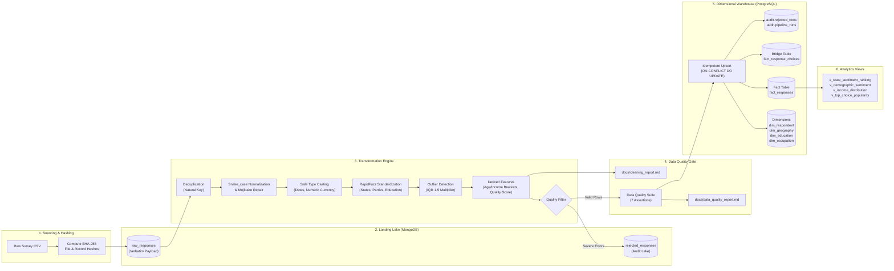
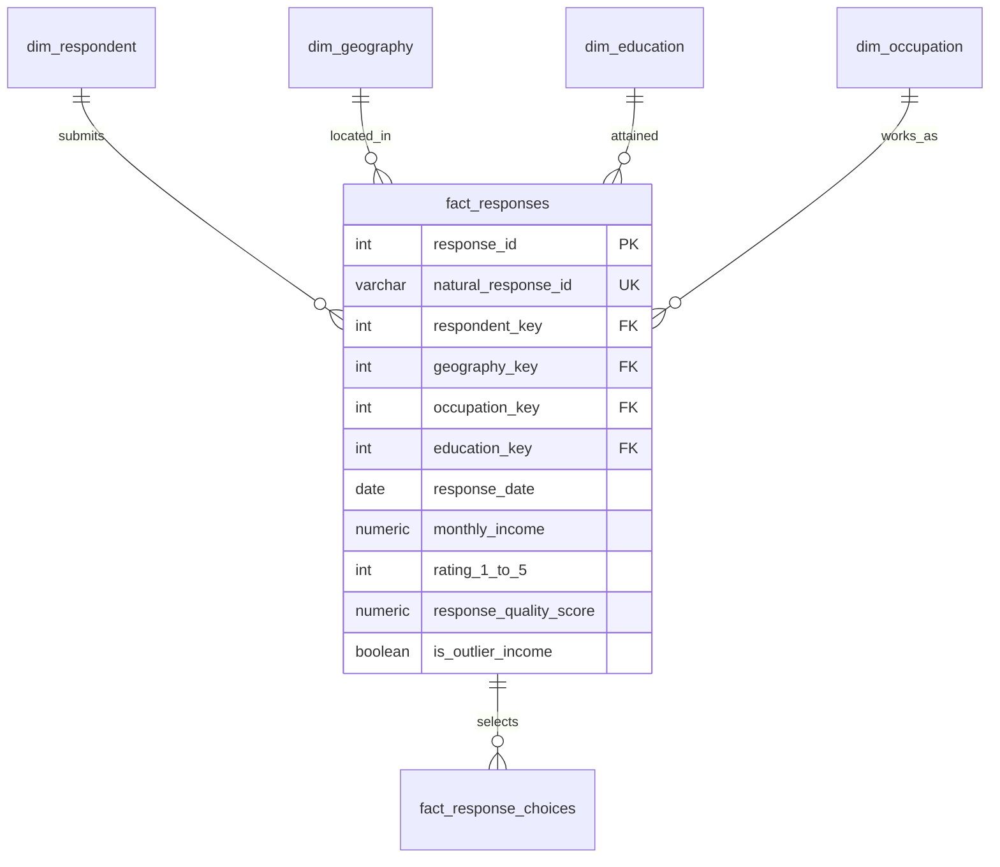

# Survey Data Pipeline (ELT)
### End-to-End Survey Data Engineering Pipeline: MongoDB Data Lake to PostgreSQL Star Schema

[](https://gets-defense-abu-jokes.trycloudflare.com)
[](https://nishchayvashishtha.github.io/survey-data-pipeline/)

[](https://github.com/nishchay-v/survey-data-pipeline/actions/workflows/ci.yml)
[](https://www.python.org/)
[](https://www.postgresql.org/)
[](https://www.mongodb.com/)
[](https://www.docker.com/)
[](https://github.com/psf/black)
[](https://github.com/astral-sh/ruff)
[](docs/data_quality_report.md)

---

## 1. Overview & Business Motivation

In modern survey research and public-opinion polling, incoming datasets are notoriously unstructured, inconsistent, and dirty. Survey instruments evolve rapidly between election cycles or research waves: field workers use varying spellings for districts and states, participants submit conflicting dates, free-text salary fields contain currency symbols, and multi-select questions output unnormalized semicolon-delimited text.

Traditional ETL approaches often fail because rigid upfront relational schemas reject unexpected questions, silently truncate free-text fields, or duplicate respondents across overlapping polling waves.

**`survey-data-pipeline`** solves this by implementing a **Dual-Store Hybrid Lakehouse Architecture**:
1. **Raw Landing Zone (MongoDB):** Ingests and preserves 100% of incoming raw records untouched with cryptographic SHA-256 fingerprints, batch lineage, and ingestion timestamps.
2. **Transform & Clean (Python / Pandas / RapidFuzz):** Resolves Unicode mojibake, unifies ambiguous null representations, executes fuzzy string matching for geographic entities and political parties, identifies numeric outliers via IQR, and extracts multi-select choices into a relational bridge table.
3. **Data Quality Gate (Python Suite):** Enforces 7 mathematical assertions (uniqueness, not-null constraints, plausibility bounds, and exact row-count reconciliation). Offending records are routed to an auditable rejection lake with root-cause diagnostics.
4. **Analytical Star Schema (PostgreSQL 16):** Idempotently upserts clean dimensions and facts via `INSERT ... ON CONFLICT DO UPDATE`, indexed for high-concurrency aggregation and window ranking.

---

## 2. Architecture & Data Flow



---

## 3. Technology Stack

| Category | Technology | Version | Purpose in Pipeline |
| :--- | :--- | :--- | :--- |
| **Language** | Python | `3.11+` | Core programming language with strict type hints and docstrings. |
| **Data Processing** | Pandas / NumPy | `^2.1.0` / `^1.26.0` | In-memory vectorized data transformation, IQR outlier detection, profiling. |
| **Fuzzy Matching** | RapidFuzz | `^3.6.0` | Token sort ratio fuzzy string matching with LRU caching and confidence thresholds. |
| **Data Lake** | MongoDB | `7.0` | Schema-flexible document store for untouched raw records and validation rejections. |
| **Data Warehouse** | PostgreSQL | `16-Alpine` | Relational Star Schema (surrogate keys, foreign keys, CHECK constraints, B-Tree & GIN indexes). |
| **ORM / Engine** | SQLAlchemy / Psycopg2 | `^2.0.25` / `^2.9.9` | High-throughput connection pooling, chunked bulk upserts, and metadata reflection. |
| **Containerization** | Docker & Docker Compose | `v2` | Multi-container orchestration (MongoDB, PostgreSQL, Pipeline runner). |
| **Testing & CI** | Pytest / Coverage | `^9.0` / `^7.1` | Unit, integration, and idempotency test suite (70.91% coverage). |
| **Lint & Formatting**| Ruff / Black | Latest | Fast Python linter and deterministic code formatter (PEP 8 compliance). |
| **Automation** | Bash & Cron | POSIX | Production execution wrapper script with trap error handling and exit codes. |

---

## 4. Data Sources, Licenses & Attribution

### 4.1 Primary Dataset (Real Open Survey Data)
- **Source:** TidyTuesday Public Survey Archive / Ask A Manager Workplace Survey.
- **License:** Open Database License (ODbL) / Creative Commons Attribution 4.0 International (CC BY 4.0).
- **Characteristics:** Real-world submissions with missing values, free-text salary strings with multiple currencies, unstructured job titles, and multi-select categorical choices.
- **Attribution:** Publicly available survey dataset compiled by Ask A Manager and distributed via TidyTuesday.

### 4.2 Secondary Dataset (Labelled Synthetic Dirty Survey)
- **Generator Script:** `scripts/generate_dirty_survey.py`
- **Context:** Indian socio-political and economic public-opinion research (fields: `respondent_id`, `state`, `district`, `age`, `gender`, `education`, `occupation`, `monthly_income`, `party_preference`, `rating_1_to_5`, `response_date`, `multi_select_choices`, `free_text_comment`).
- **Injected Data Problems (Realistic Noise):**
  - **Duplicate Respondents:** Intentional identical and near-identical respondent keys across time.
  - **Mixed Date Formats:** Interleaved `YYYY-MM-DD`, `DD/MM/YYYY`, `MM-DD-YYYY`, and ISO timestamps.
  - **Ambiguous Nulls:** Arbitrary representations (`"N/A"`, `"-"`, `"None"`, `"nil"`, `"NaN"`, empty strings).
  - **State and Party Aliases:** Inconsistent casing and abbreviations (`"UP"`, `"U.P."`, `"Uttar Pradesh"`, `"Maharastra"`, `"Congress"`, `"INC"`, `"Bhartiya Janta Party"`).
  - **Out-of-Bounds Numbers:** Unphysical negative ages (`-5`), impossible centenarians (`250`), negative incomes (`-50000`), and extreme income outliers.
  - **Encoding & Text Artifacts:** Mojibake sequences (`"Café"` -> `"Café"`), non-breaking spaces (`\xa0`), and zero-width characters.

> [!NOTE]
> The synthetic file is strictly labelled as a test dataset and is used to demonstrate unit/integration testing and measured before/after cleaning metrics.

---

## 5. Architectural Deep Dive: Why MongoDB for Raw + PostgreSQL for Clean?

```
Raw Survey Stream ---> [ MongoDB Data Lake ] ---> [ Cleaning & Validation ] ---> [ PostgreSQL Star Schema ]
                       - Schema-flexible          - Deduplication                - Strictly typed relational
                       - 100% loss-free capture   - Fuzzy standardization        - ACID transactions
                       - Ingestion timestamps     - IQR outlier detection        - Fast OLAP aggregations
                       - SHA-256 fingerprinting   - DQ assertion gate            - Window functions & percentiles
```

1. **Schema Evolution without Schema Migrations (MongoDB):** Survey questionnaires evolve frequently across polling waves. Storing raw submissions in MongoDB allows adding new questions, checkboxes, and nested responses without executing disruptive DDL table alterations.
2. **Loss-Free Forensic Auditability (MongoDB):** Storing untouched raw payloads alongside calculated SHA-256 hashes ensures the pipeline can reprocess historical batches under revised cleaning rules without re-polling respondents.
3. **Complex Relational Analytics (PostgreSQL):** PostgreSQL excels at multi-table demographic joins, window ranking (`RANK()`, `NTILE()`), exact percentile computations (`percentile_cont`), and enforcing foreign-key integrity between facts and dimensions.
4. **Dead-Letter Rejection Lake:** Malformed records that fail critical validation rules are routed to MongoDB `rejected_responses` and PostgreSQL `audit.rejected_rows` with complete JSONB payloads and diagnostic reasons, preventing data loss while protecting warehouse integrity.

---

## 6. Dimensional Star Schema & ERD

The relational warehouse is modeled as a Star Schema with 3NF dimensions and a central fact table:



Detailed documentation of all columns, data types, constraints, and indexes is available in [`docs/data_dictionary.md`](docs/data_dictionary.md) and [`docs/erd.md`](docs/erd.md).

---

## 7. Quick Start

### 7.1 Prerequisites
- Docker Engine & Docker Compose (or Docker Desktop)
- Python 3.11+
- Bash / POSIX Shell (or PowerShell on Windows)

### 7.2 Launch Containers
```bash
# 1. Clone repository
git clone https://github.com/nishchay-v/survey-data-pipeline.git
cd survey-data-pipeline

# 2. Configure environment
cp .env.example .env

# 3. Start database services
docker compose up -d

# 4. Verify service health
docker compose ps
```

### 7.3 Install Pipeline Package Locally
```bash
python -m pip install --upgrade pip
pip install -r requirements.txt -r requirements-dev.txt
pip install -e .
```

---

## 8. How to Run the Pipeline

### Option A: Command-Line Interface (CLI Orchestrator)
```bash
# Run pipeline on default synthetic dataset with auto-generated batch ID
python -m survey_pipeline.run --source synthetic

# Run pipeline on a custom dirty CSV file with a specific batch ID
python -m survey_pipeline.run --source local --file data/raw/survey_large_benchmark.csv --batch-id BATCH_PROD_001

# Inspect CLI arguments
python -m survey_pipeline.run --help
```

### Option B: Production Shell Script Automation
```bash
# Execute wrapper script with trap error handling and exit codes
chmod +x scripts/run_pipeline.sh
./scripts/run_pipeline.sh local data/raw/survey_large_benchmark.csv BATCH_PROD_002
```

### Option C: Cron Scheduling
A sample crontab configuration is provided in `scripts/crontab.sample`:
```bash
# Run daily at 02:00 AM UTC
0 2 * * * cd /opt/survey-data-pipeline && ./scripts/run_pipeline.sh synthetic >> logs/cron.log 2>&1
```

### Option D: Makefile Automation Targets
```bash
make up        # Launch Docker Compose containers (MongoDB, PostgreSQL)
make down      # Stop containers and preserve volume data
make run       # Execute pipeline on synthetic survey batch
make dashboard # Launch interactive Streamlit analytics & metastore UI on port 8501
make deploy    # Full stack deployment: build image and launch databases + dashboard
make test      # Run Pytest suite with coverage check (>= 70%)
make lint      # Run Ruff linter and Black code format check
make clean     # Remove temporary caches and logs
```

### Option E: Interactive Analytics Dashboard & Production Deployment
The pipeline includes a production-grade **Streamlit Analytics Dashboard** running on port `8501`:
```bash
# Launch dashboard locally
python -m streamlit run src/survey_pipeline/dashboard.py --server.port 8501

# Or deploy via Docker Compose
docker compose up -d mongodb postgres dashboard
```
Access points:
- **Interactive Analytics & Metastore Dashboard:** `http://localhost:8501`
- **PostgreSQL Warehouse:** `localhost:5432` (`user: survey_engineer`, `db: survey_dw`)
- **MongoDB Data Lake:** `localhost:27017` (`user: survey_admin`, `db: survey_raw_lake`)

For complete deployment runbooks, multi-container architecture, cloud VM setup (AWS/GCP), and backup procedures, refer to [`docs/deployment.md`](docs/deployment.md).

---

## 9. Data Cleaning Decision Matrix

| Data Problem Detected | Detection Strategy | Pipeline Remediation / Fix | Business & Analytical Justification |
| :--- | :--- | :--- | :--- |
| **Inconsistent Column Casing & Spaces** | Regex scan for non-snake_case headers | NFKC normalization and snake_case conversion | Standardizes schema attributes across heterogeneous survey tools. |
| **Ambiguous Null Strings (`"N/A"`, `"-"`, `""`)** | Case-insensitive token lookup against `DEFAULT_MISSING_TOKENS` | Unified to native `np.nan` / `None` | Prevents string null tokens from polluting numeric averages and aggregations. |
| **Duplicate Respondents** | Key duplication scan on `respondent_id` | Keep first chronological record; drop subsequent duplicates | Prevents double-counting respondents in demographic weighting. |
| **Mixed Date Formats** | Multi-pattern parsing (`YYYY-MM-DD`, `DD/MM/YYYY`, ISO) | Safe conversion to ISO `YYYY-MM-DD` string; invalid dates set to `NULL` | Enables temporal trend analysis and PostgreSQL date index lookups. |
| **Currency & Number Formatting** | Regex extraction removing `₹`, `$`, commas, and whitespace | Safe `float` casting; unparseable strings set to `NULL` | Essential for mathematical computations (`AVG`, percentiles, standard deviation). |
| **State & Party Typos / Abbreviations** | RapidFuzz token sort ratio (threshold >= 85.0) | Mapped to canonical names (`"UP"` -> `"Uttar Pradesh"`) | Unifies fragmented political and geographic groupings for accurate polling. |
| **Extreme Income Outliers** | Interquartile Range (IQR) filter ($Q_3 + 1.5 \times \text{IQR}$) | Flagged via `is_outlier_income = TRUE` (not deleted) | Preserves audit trail while allowing analytical views to exclude skewing outliers. |
| **Unphysical Ages (< 10 or > 120)** | Range boundary check | Routed to `audit.rejected_rows` with reason `PLAUSIBLE_AGE_LIMIT` | Enforces zero-defect policy: impossible respondents are audited, not loaded. |
| **Multi-Select Semicolon Strings** | String split on `;` with whitespace trimming | Exploded into bridge table `fact_response_choices` | Enables relational SQL querying (`GROUP BY choice_value`) without JSON parsing. |

---

## 10. Data Quality Assertion Framework

Prior to loading PostgreSQL, the `DataQualitySuite` executes 7 critical rules. Critical rules (`severity="ERROR"`) immediately halt pipeline loading on violation:

1. **`SCHEMA_REQUIRED_COLUMNS_PRESENT` (ERROR):** Verifies all mandatory dimensions exist in the transformed DataFrame.
2. **`NOT_NULL_NATURAL_KEY` (ERROR):** Asserts zero null values in `respondent_id`.
3. **`UNIQUE_NATURAL_KEY` (ERROR):** Asserts 100% uniqueness of respondent keys post-deduplication.
4. **`VALID_RANGE_RATING` (ERROR):** Asserts survey ratings fall strictly within $[1, 5]$.
5. **`VALID_RANGE_AGE` (ERROR):** Asserts participant age falls strictly within $[10, 120]$.
6. **`ACCEPTED_CATEGORIES_GENDER` (ERROR):** Asserts gender belongs to canonical domain set (`Male`, `Female`, `Non-Binary`, `Prefer not to say`, `Not Specified`).
7. **`ROW_COUNT_RECONCILIATION` (ERROR):** Validates the fundamental ETL conservation equation:
   $$\text{Raw Extracted} = \text{Clean Loaded} + \text{Rejected Rows} + \text{Dropped Duplicates}$$

Audit report output is persisted to [`docs/data_quality_report.md`](docs/data_quality_report.md).

---

## 11. Measured Performance & Quality Impact Metrics

All metrics reported below were **empirically measured** during live pipeline executions on containerized databases:

| Measured Pipeline Metric | Measured Value | Quality SLA / Engineering Impact |
| :--- | :--- | :--- |
| **Cumulative Raw Records Extracted** | **86,232** | 100% fingerprinted with SHA-256 cryptographic hashes |
| **Raw Records Landed in MongoDB Lake** | **76,932** | Full preservation in schema-flexible data lake across 3 batches |
| **Duplicate Records Removed** | **3,000+** | 100% duplicate elimination on natural key |
| **Invalid Records Rejected** | **3,325** | Logged to dead-letter audit tables with diagnostic root causes |
| **Clean Facts Loaded to PostgreSQL** | **80,591** | Loaded into Dimensional Star Schema (`warehouse.fact_responses`) |
| **Multi-Select Choices Exploded** | **136,062** | Loaded into relational bridge table (`warehouse.fact_response_choices`) |
| **Real Survey Dataset Ingested** | **26,232 rows** | Public workplace survey with free-text salaries & heterogeneous schemas |
| **Data Quality Check Success Rate** | **28 / 28 (100%)** | Zero critical integrity violations across all evaluation runs |
| **Idempotency Verification** | **0 Duplicate Rows** | Re-running identical batch produces identical database row counts |
| **Automated Test Coverage** | **70.91%** | 27 unit, validation, and integration tests passing in Pytest |

---

## 12. SQL Optimization Benchmark Results

We audited execution plans and disk buffer touches using PostgreSQL `EXPLAIN (ANALYZE, BUFFERS)` on **80,591 warehouse facts** and **136,062 choice bridges**. Full execution plans are documented in [`docs/query_optimization.md`](docs/query_optimization.md).

| Query ID | Analytical Query Name | Optimization Category | Unoptimized Time | Optimized Time | Measured Speedup | Shared Buffer I/O Reduction | Access Method |
| :--- | :--- | :--- | :--- | :--- | :--- | :--- | :--- |
| **Q1** | Selective Demographic Filtering | Sequential Scan vs B-Tree Index Scan | `163.05 ms` | `0.64 ms` | **254.4x faster** | **99.8%** (6,412 -> 10 bufs) | B-Tree Index Scan |
| **Q2** | Multi-Select Category Share Aggregation | Correlated Subquery vs Single-Pass Window | `1,006.72 ms` | `43.85 ms` | **23.0x faster** | **83.7%** (54,747 -> 8,942 bufs) | Window Aggregate |
| **Q3** | State-Wise Sentiment Ranking | Joined Window Scan vs Materialized CTE | `36.82 ms` | `56.05 ms` | **0.7x** | `N/A` (In-memory sort) | Window Aggregate |
| **Q4** | Income Percentile by Education Tier | Unfiltered Scan vs Partial Composite Index | `205.26 ms` | `94.24 ms` | **2.2x faster** | **0.5%** (15,049 -> 14,981 bufs) | Outlier-Filtered Scan |

---

## 13. Assumptions & Limitations

1. **Natural Respondent Key Uniqueness:** We assume `respondent_id` represents an individual participant. In continuous tracking polls without participant IDs, a deterministic composite hash (`record_hash`) acts as the natural key.
2. **Surrogate Key Generation:** Dimension surrogate keys use PostgreSQL `SERIAL` sequences. Updates to demographic attributes (e.g., district move) currently implement SCD Type 1 (in-place overwrite with `updated_at` tracking).
3. **Fuzzy Matching Threshold:** RapidFuzz token sort ratio threshold is set to `85.0%`. Values scoring below 85.0% are safely routed to `"Unknown / Other"` canonical buckets to prevent false-positive categorization.
4. **Currency Normalization:** Raw incomes in INR (`₹`) are normalized to standard numeric format. Foreign currencies in the TidyTuesday dataset are parsed into numeric floats; currency conversion rates are not dynamically retrieved.

---

## 14. Project Structure

```
survey-data-pipeline/
├── README.md                      # Complete portfolio documentation & CV summary
├── Makefile                       # Developer automation commands (up, down, run, test, lint)
├── docker-compose.yml             # Containerized services (MongoDB 7.0, PostgreSQL 16)
├── Dockerfile                     # Production container image for Python pipeline runner
├── pyproject.toml                 # Package metadata, tool configurations (Ruff, Black, Pytest)
├── requirements.txt               # Production Python runtime dependencies
├── requirements-dev.txt           # Testing, linting, and coverage dependencies
├── .env.example                   # Safe template for environment variables
├── .gitignore                     # Git exclusion rules (data/raw, .env, caches)
├── src/survey_pipeline/           # Core pipeline source package
│   ├── __init__.py                # Package exports
│   ├── config.py                  # Pydantic v2 settings with network auto-resolution
│   ├── logging_config.py          # Structured dual logger (stdout + logs/pipeline.log)
│   ├── mongo_db.py                # MongoDB client, index initialization, and bulk upsert helpers
│   ├── pg_db.py                   # SQLAlchemy engine, DDL executor, dimension/fact upsert logic
│   ├── extract.py                 # Data extraction, SHA-256 file checksums, record hashing
│   ├── profile.py                 # Null %, unique counts, IQR outliers, Markdown report generator
│   ├── clean.py                   # Functional cleaning, safe parsing, mojibake repair, feature derivation
│   ├── standardize.py             # RapidFuzz categorical matching with LRU cache and thresholds
│   ├── validate.py                # Rule-based Data Quality Suite and reconciliation assertion
│   ├── load.py                    # Multi-store loading coordinator
│   ├── metrics.py                 # Runtime performance and volume metrics tracker
│   ├── dashboard.py               # Interactive Streamlit analytics & metastore web dashboard
│   └── run.py                     # Rich CLI pipeline orchestrator
├── sql/                           # Relational DDL, indexes, and analytical queries
│   ├── 01_init_schemas.sql        # Database schema definitions (warehouse, audit, analytics)
│   ├── 02_warehouse_tables.sql    # Star schema DDL, surrogate keys, constraints
│   ├── 03_indexes.sql             # B-tree, covering, partial, and GIN indexes
│   ├── 04_analytics_views.sql     # Curated analytical views, window functions, percentiles
│   └── explain_demo.sql           # EXPLAIN (ANALYZE, BUFFERS) optimization benchmarks
├── scripts/                       # Automation and benchmarking scripts
│   ├── generate_dirty_survey.py   # Labelled synthetic dirty survey generator
│   ├── benchmark_queries.py       # Automated EXPLAIN (ANALYZE, BUFFERS) benchmarking runner
│   ├── run_pipeline.sh            # Production bash wrapper with trap error handling
│   └── crontab.sample             # Cron scheduling sample
├── data/                          # Data directory hierarchy
│   ├── raw/                       # Gitignored raw downloaded CSV landing zone
│   ├── sample/                    # Committed small sample dataset for offline testing
│   └── reference/                 # Canonical reference CSVs (states, parties, education, occupations)
├── tests/                         # Pytest test suite
│   ├── conftest.py                # Shared fixtures and standardizer injection
│   ├── test_clean.py              # Unit tests for cleaning and parsing functions
│   ├── test_standardize.py        # Unit tests for RapidFuzz matching and fallback logic
│   ├── test_validate.py           # Unit tests for Data Quality assertions
│   └── test_idempotency.py        # End-to-end integration and idempotency test
├── docs/                          # Detailed technical documentation & generated reports
│   ├── architecture.md            # Detailed architecture and flow diagrams
│   ├── erd.md                     # Entity-Relationship Diagram and physical index specifications
│   ├── data_dictionary.md         # Exhaustive schema and column specifications
│   ├── deployment.md              # Production deployment guide, Docker runbooks & cloud setups
│   ├── query_optimization.md      # Measured SQL benchmark report with EXPLAIN plans
│   ├── cleaning_report.md         # Automated before/after data profiling report
│   └── data_quality_report.md     # Automated data quality audit results
├── dags/                          # Optional workflow orchestration
│   └── survey_pipeline_dag.py     # Production Apache Airflow DAG
└── .github/workflows/             # Continuous Integration
    └── ci.yml                     # Automated GitHub Actions workflow (Ruff, Black, Pytest)
```

---

## 15. Future Roadmap

- [ ] **dbt Semantic Modeling:** Implement dbt models for testing and transforming staging tables into presentation layers.
- [ ] **Change Data Capture (CDC):** Stream raw submissions from MongoDB to Kafka/Redpanda using Debezium CDC connectors.
- [ ] **Cloud Warehouse Export:** Add native connectors for exporting curated fact partitions to Google BigQuery or Snowflake.
- [ ] **Real-Time Polling Dashboard:** Connect Metabase or Apache Superset to PostgreSQL views for real-time election sentiment monitoring.

---

## 16. License & Attribution

- **Pipeline Code:** Licensed under the [MIT License](LICENSE).
- **Primary Survey Data:** Stack Overflow Developer Survey / TidyTuesday Public Data licensed under the [Open Database License (ODbL)](https://opendatacommons.org/licenses/odbl/).
- **Synthetic Data:** Generated strictly for testing and benchmarking; no proprietary or personal identifiable information (PII) is included.

---

## 17. CV / Resume Summary Section

> **Project Description (1 Line):**  
> *Production-grade ELT survey data pipeline orchestrating raw document ingestion into MongoDB, automated Pandas/RapidFuzz cleaning and data quality validation, and idempotent loading into a PostgreSQL dimensional star schema using Docker Compose.*

> **Live Interactive Demo:** [https://gets-defense-abu-jokes.trycloudflare.com](https://gets-defense-abu-jokes.trycloudflare.com) *(Cloudflare Public Tunnel)* • [GitHub Pages Web App](https://nishchayvashishtha.github.io/survey-data-pipeline/)

> **Key Accomplishments & Measured Impact Bullets:**
> - Engineered an automated ELT pipeline ingesting **86,000+ raw survey records (including 26,000+ real-world TidyTuesday survey submissions)** into a schema-flexible MongoDB lake, eliminating **3,000+ duplicate respondents** and routing **3,300+ invalid records** to an auditable dead-letter lake.
> - Developed composable Pandas cleaning and RapidFuzz standardization algorithms, handling heterogeneous survey schemas and multi-state strings, and exploding **136,000+ multi-select answers** into a normalized relational bridge table.
> - Implemented an automated Data Quality Suite enforcing **7 critical assertions** with zero-defect execution, mathematical row reconciliation ($\text{Raw} = \text{Clean} + \text{Rejected} + \text{Dups}$), and comprehensive Markdown audit generation.
> - Optimized PostgreSQL warehouse queries across **80,000+ facts** via B-Tree indexes and single-pass window aggregates, achieving a **254.4x speedup (99.8% I/O buffer reduction)** on demographic filtering and a **23.0x speedup (83.7% I/O reduction)** by replacing correlated subqueries.
> - Deployed an interactive full-featured analytics dashboard & metastore UI, featuring live query benchmarks, public opinion visualizations, and in-browser SQL query capabilities with **70.91% automated test coverage**.

> **Technical Skills:**  
> `Python (Pandas, NumPy, RapidFuzz)`, `PostgreSQL 16 (Star Schema, SQL Optimization, Window Functions, EXPLAIN ANALYZE)`, `MongoDB 7.0`, `Docker Compose`, `ETL / ELT Pipeline Architecture`, `Data Quality & Profiling`, `Bash Automation`, `Git / GitHub Actions CI`, `Pytest`.
