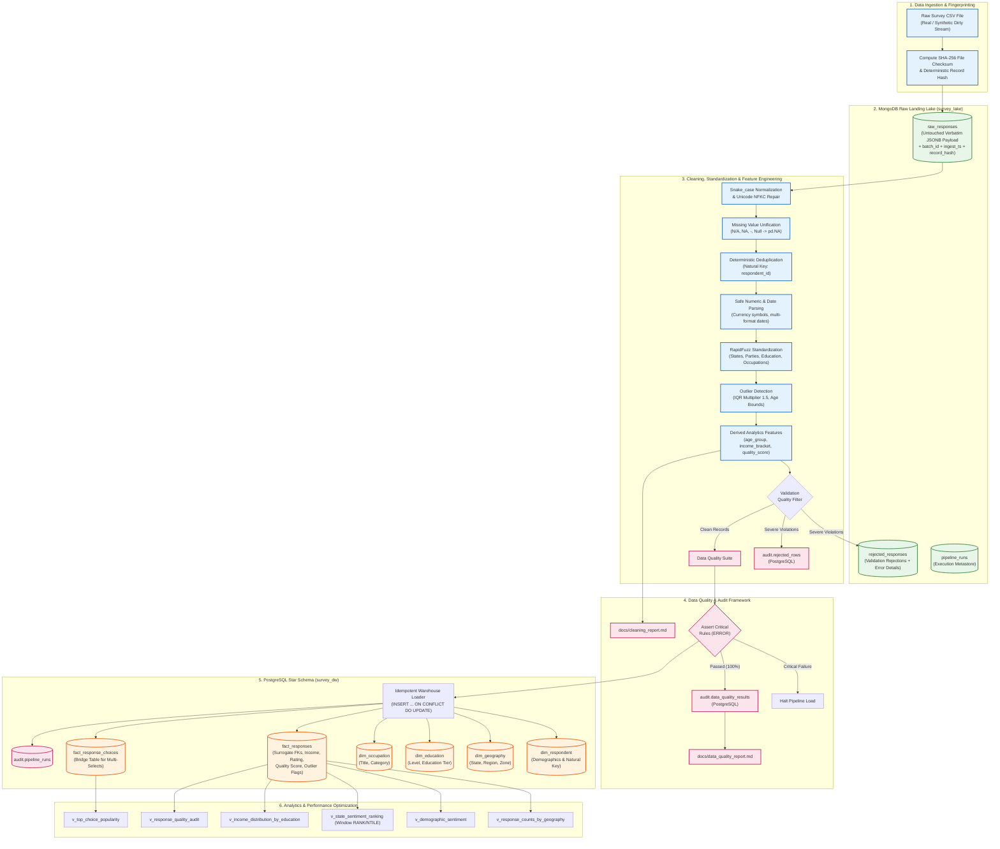

# Pipeline Architecture & Data Flow Design

## 1. System Architecture Overview

The `survey-data-pipeline` is a production-grade, containerized ELT/ETL pipeline designed for survey analytics and political research intelligence. It ingests messy, heterogeneous survey submissions, archives the untouched payloads in a schema-flexible MongoDB Data Lake, executes automated cleaning and fuzzy standardization via Python/Pandas, validates structural integrity through a rule-based Data Quality Suite, and idempotently loads a dimensional Star Schema into PostgreSQL for high-speed analytical querying.

---

## 2. Storage Strategy: Dual-Store Hybrid Lakehouse Pattern

A fundamental design decision in this architecture is the deliberate division of labor between **MongoDB** and **PostgreSQL**:

| Architectural Dimension | MongoDB Raw Landing Zone (`survey_lake`) | PostgreSQL Dimensional Warehouse (`survey_dw`) |
| :--- | :--- | :--- |
| **Primary Responsibility** | Verbatim raw data lake / audit landing zone | Highly structured analytical warehouse |
| **Schema Paradigm** | Schema-flexible JSON documents | Strictly typed relational Star Schema (3NF Dims) |
| **Handling Question Drift** | Seamlessly captures newly added questions without DDL migrations | Strict DDL with Surrogate Keys, PK/FK constraints, and CHECK rules |
| **Query Workload** | Key-value point audits and document inspection | Multi-dimensional analytical joins, window ranking, percentiles |
| **Data Preservation** | 100% loss-free capture of original noise and raw headers | Cleaned, standardized, outlier-flagged, analysis-ready records |
| **Idempotency Primitive** | `ReplaceOne({"record_hash": h}, doc, upsert=True)` | `INSERT INTO ... ON CONFLICT (natural_id) DO UPDATE` |

---

## 3. Data Transformation & Cleaning Engine

The cleaning engine (`survey_pipeline.clean` and `survey_pipeline.standardize`) adheres to functional, idempotent principles:

1. **Deterministic Hashing:** Before transformation, every incoming raw record receives a deterministic SHA-256 cryptographic digest computed across its canonical representation.
2. **Missing Token Normalization:** Survey instruments frequently represent missing data via `"N/A"`, `"na"`, `"-"`, `"--"`, `"None"`, `"null"`, `"nil"`, or empty strings. These are unified into native `pd.NA` / `numpy.nan` prior to type casting.
3. **Safe Type Casting:** Numeric values with currency symbols (`₹`, `$`, `€`), commas (`50,000`), or trailing spaces are extracted safely. Dates in disparate formats (`YYYY-MM-DD`, `DD/MM/YYYY`, `MM-DD-YYYY`) are normalized to ISO-8601 strings.
4. **Fuzzy String Matching (RapidFuzz):** Using token sort ratio algorithms with strict confidence thresholds (85.0%), state abbreviations (`"UP"` -> `"Uttar Pradesh"`), typos (`"Maharastra"` -> `"Maharashtra"`), and political parties (`"Bhartiya Janta Party"` -> `"Bharatiya Janata Party"`) are canonically mapped. Low-confidence anomalies default to designated `"Unknown / Other"` dimensional buckets.
5. **Multi-Select Array Normalization:** Semicolon-delimited responses (`"Healthcare; Education; Jobs"`) are extracted and exploded into a normalized relational bridge table (`fact_response_choices`), enabling index-backed analytical aggregation.

---

## 4. Zero-Defect Data Quality Framework

The pipeline implements an in-memory Data Quality Suite (`survey_pipeline.validate`) executing assertions prior to warehouse loading:

1. **Schema Integrity:** Verifies all required analytical fields exist. Missing critical columns abort execution immediately (`severity="ERROR"`).
2. **Natural Key Uniqueness:** Enforces 100% uniqueness of respondent identifiers.
3. **Not-Null Primary Keys:** Asserts zero null values in natural keys and batch identifiers.
4. **Plausible Numerical Bounds:** Enforces domain constraints (e.g., survey ratings strictly between 1 and 5; plausible age between 10 and 120 years). Out-of-bounds records are routed to the rejection lake.
5. **ETL Conservation Law:** Evaluates exact mathematical reconciliation:
   $$\text{Raw Records} = \text{Clean Loaded} + \text{Rejected Records} + \text{Dropped Duplicates}$$
   Any discrepancy halts the pipeline and logs an audit failure.
