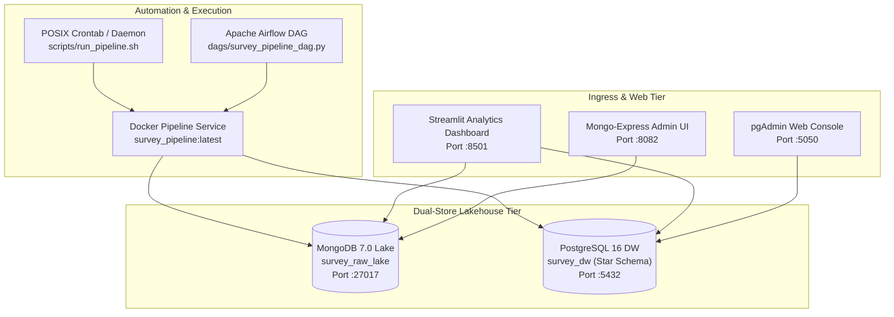

# Production Deployment Guide: Survey Data Pipeline

This document details the multi-tier production deployment architecture, configuration patterns, container orchestration, scheduling, and operational runbooks for **`survey-data-pipeline`**.

---

## 1. Deployment Topology & Architecture

The pipeline implements a **Dual-Store Hybrid Lakehouse Architecture** containerized with Docker Compose.



### Deployed Services & Network Port Allocations

| Service Name | Container Name | Base Image | Host Port | Internal Port | Healthcheck Mechanism |
| :--- | :--- | :--- | :--- | :--- | :--- |
| **`postgres`** | `survey_postgres` | `postgres:16-alpine` | `5432` | `5432` | `pg_isready -U survey_engineer -d survey_dw` |
| **`mongodb`** | `survey_mongodb` | `mongo:7.0` | `27017` | `27017` | `mongosh --eval 'db.adminCommand("ping")'` |
| **`dashboard`** | `survey_dashboard` | `cloud_data_warehouse-pipeline:latest` | `8501` | `8501` | `curl -f http://localhost:8501/_stcore/health` |
| **`pipeline`** | `survey_pipeline` | `cloud_data_warehouse-pipeline:latest` | N/A (CLI) | N/A | Exit code verification (0 = Success) |
| **`mongo-express`**| `survey_mongo_express`| `mongo-express:latest` | `8082` | `8081` | HTTP GET `/` |
| **`pgadmin`** | `survey_pgadmin` | `dpage/pgadmin4:latest` | `5050` | `80` | HTTP GET `/misc/ping` |

---

## 2. Quick-Start Deployment Instructions

### Option A: Complete Docker Compose Stack (Recommended)

To deploy the databases, analytics dashboard, and pipeline runner in background daemon mode:

```bash
# 1. Clone the repository and configure environment
git clone https://github.com/nishchay-v/survey-data-pipeline.git
cd survey-data-pipeline
cp .env.example .env

# 2. Build the production Docker image
docker compose build pipeline

# 3. Start database services and analytical dashboard
docker compose up -d mongodb postgres dashboard

# 4. Verify service health
docker compose ps
```

Access Points:
- **Interactive Analytics Dashboard:** `http://localhost:8501`
- **PostgreSQL Warehouse:** `localhost:5432` (`user: survey_engineer`, `db: survey_dw`)
- **MongoDB Data Lake:** `localhost:27017` (`user: survey_admin`, `db: survey_raw_lake`)

### Option B: Local Python Execution with Containerized Databases

```bash
# 1. Start database containers
docker compose up -d mongodb postgres

# 2. Install local Python dependencies
python -m pip install -r requirements-dev.txt

# 3. Run the pipeline CLI
python -m survey_pipeline.run --source synthetic --batch-id BATCH_PROD_001

# 4. Launch the Streamlit Analytics Dashboard
python -m streamlit run src/survey_pipeline/dashboard.py --server.port 8501
```

---

## 3. Production Scheduling & Automation

### Automated Execution Wrapper (`scripts/run_pipeline.sh`)

The pipeline includes a production-grade POSIX shell wrapper with:
- `set -euo pipefail` strict execution semantics.
- Signal traps (`EXIT`, `INT`, `TERM`) for graceful clean-up and failure logging.
- Database liveness pre-checks before triggering extraction.
- Automatic log rotation to `logs/pipeline_$(date +%Y%m%d).log`.

```bash
#!/usr/bin/env bash
# Make executable
chmod +x scripts/run_pipeline.sh

# Run synthetic batch
./scripts/run_pipeline.sh --source synthetic

# Run real TidyTuesday survey ingestion
./scripts/run_pipeline.sh --source real
```

### Production Crontab Setup

To schedule automated daily execution at 03:00 UTC:

```bash
# Edit crontab
crontab -e

# Add automated daily pipeline run:
0 3 * * * /bin/bash /opt/survey-data-pipeline/scripts/run_pipeline.sh >> /var/log/survey_pipeline.log 2>&1
```

### Apache Airflow Orchestration

An enterprise Airflow DAG is provided in [`dags/survey_pipeline_dag.py`](../dags/survey_pipeline_dag.py):
- Daily schedule (`0 3 * * *`) with automatic retries (2 retries, 5-minute backoff).
- Task-level dependencies: `check_database_health >> extract_raw_to_mongodb >> transform_validate_load_pg`.

---

## 4. Cloud Deployment (AWS EC2 / GCP Compute Engine / Ubuntu VM)

### 1. VM Provisioning Recommendations
- **Instance Type:** `t3.medium` (AWS) / `e2-standard-2` (GCP) — 2 vCPUs, 4 GB RAM.
- **Operating System:** Ubuntu 22.04 LTS / Debian 12.
- **Storage:** 40 GB gp3 SSD (accommodates 1M+ survey responses and index structures).

### 2. Firewall & Security Group Configuration
- **Inbound Rules:**
  - `Port 22 (SSH):` Restricted to administrative CIDR / VPN.
  - `Port 80 / 443 (HTTP/HTTPS):` Public (routed through Nginx reverse proxy).
  - `Port 5432 & 27017:` **Private / Internal Only** (never expose database ports directly to `0.0.0.0/0`).

### 3. Nginx Reverse Proxy with Let's Encrypt SSL
```nginx
# /etc/nginx/sites-available/survey-dashboard.conf
server {
    server_name survey-analytics.yourdomain.com;

    location / {
        proxy_pass http://localhost:8501;
        proxy_http_version 1.1;
        proxy_set_header Upgrade $http_upgrade;
        proxy_set_header Connection "upgrade";
        proxy_set_header Host $host;
        proxy_set_header X-Real-IP $remote_addr;
        proxy_read_timeout 86400;
    }
}
```

```bash
sudo certbot --nginx -d survey-analytics.yourdomain.com
```

---

## 5. Backup, Disaster Recovery & Maintenance

### PostgreSQL Warehouse Backup (`pg_dump`)
```bash
# Snapshot star schema warehouse and audit tables
docker exec -t survey_postgres pg_dump -U survey_engineer -d survey_dw -F c -b -v -f /var/lib/postgresql/data/survey_dw_$(date +%Y%m%d).dump

# Restore star schema
docker exec -t survey_postgres pg_restore -U survey_engineer -d survey_dw -v /var/lib/postgresql/data/survey_dw_20261103.dump
```

### MongoDB Raw Lake Backup (`mongodump`)
```bash
# Archive raw documents and dead-letter collections
docker exec -t survey_mongodb mongodump --username survey_admin --password survey_secret_pass --authenticationDatabase admin --db survey_raw_lake --archive=/data/db/survey_lake_$(date +%Y%m%d).archive

# Restore archive
docker exec -t survey_mongodb mongorestore --username survey_admin --password survey_secret_pass --authenticationDatabase admin --archive=/data/db/survey_lake_20261103.archive
```

---

## 6. Operational Health Checks & Verification

Verify full pipeline health after deployment:

```bash
# 1. Check all container statuses
docker compose ps

# 2. Check PostgreSQL connection & table counts
python -c "
from survey_pipeline.config import PipelineSettings
from survey_pipeline.pg_db import get_pg_engine
from sqlalchemy import text
engine = get_pg_engine(PipelineSettings().postgres.url)
with engine.connect() as conn:
    print('Fact responses:', conn.execute(text('SELECT count(*) FROM warehouse.fact_responses')).scalar())
"

# 3. Check MongoDB document counts
python -c "
from survey_pipeline.config import PipelineSettings
from survey_pipeline.mongo_db import get_database
settings = PipelineSettings()
db = get_database(settings.mongo.uri, settings.mongo.db)
print('MongoDB raw docs:', db.raw_responses.count_documents({}))
"

# 4. Verify Streamlit Dashboard HTTP 200
curl -I http://localhost:8501
```
