# Relational Data Warehouse Entity-Relationship Diagram (ERD)

## 1. Dimensional Star Schema Architecture

The PostgreSQL data warehouse (`survey_dw`) employs a Star Schema optimized for OLAP analytics, demographic cross-tabulations, and public-opinion sentiment modeling.

```mermaid
erDiagram
    DIM_RESPONDENT ||--o{ FACT_RESPONSES : "submits"
    DIM_GEOGRAPHY ||--o{ FACT_RESPONSES : "located_in"
    DIM_EDUCATION ||--o{ FACT_RESPONSES : "attained"
    DIM_OCCUPATION ||--o{ FACT_RESPONSES : "works_as"
    FACT_RESPONSES ||--o{ FACT_RESPONSE_CHOICES : "selects"
    
    AUDIT_PIPELINE_RUNS ||--o{ AUDIT_REJECTED_ROWS : "logs"
    AUDIT_PIPELINE_RUNS ||--o{ AUDIT_DATA_QUALITY_RESULTS : "audits"

    DIM_RESPONDENT {
        int respondent_key PK "Surrogate Key (SERIAL)"
        varchar natural_respondent_id UK "Natural Business Key (e.g. RESP_001)"
        varchar gender "Standardized Gender (Male, Female, Non-Binary)"
        int age "Cleaned Age (10 to 120)"
        varchar age_group "Derived Bracket (<18, 18-25, 26-35, etc.)"
        varchar district "District Name"
        varchar first_seen_batch_id "Batch Lineage Tracker"
        timestamp updated_at "SCD Type 1 Timestamp"
    }

    DIM_GEOGRAPHY {
        int geography_key PK "Surrogate Key (SERIAL)"
        varchar state_name UK "Canonical State Name"
        varchar state_code "2-letter ISO Code (e.g. UP, MH, DL)"
        varchar region "Geographic Region (North, South, etc.)"
        varchar zone "Administrative Zone"
    }

    DIM_EDUCATION {
        int education_key PK "Surrogate Key (SERIAL)"
        varchar education_level UK "Canonical Education Title"
        varchar education_tier "Tier (Higher Education, Secondary, Unknown)"
    }

    DIM_OCCUPATION {
        int occupation_key PK "Surrogate Key (SERIAL)"
        varchar occupation_title UK "Canonical Job Title"
        varchar occupation_category "Industry Vertical (Technology, Healthcare, etc.)"
    }

    FACT_RESPONSES {
        int response_id PK "Surrogate Primary Key (SERIAL)"
        varchar natural_response_id UK "Natural Compound Key (respondent_id + batch_id)"
        int respondent_key FK "Surrogate FK -> dim_respondent"
        int geography_key FK "Surrogate FK -> dim_geography"
        int occupation_key FK "Surrogate FK -> dim_occupation"
        int education_key FK "Surrogate FK -> dim_education"
        varchar batch_id "Pipeline Execution Batch ID"
        varchar source_file "Source Origin File"
        date response_date "Normalized ISO Date (YYYY-MM-DD)"
        varchar party_preference "Canonical Political Party Preference"
        numeric monthly_income "Cleaned Numeric Monthly Income (INR)"
        varchar income_bracket "Derived Bracket (<25k, 25k-50k, 50k-100k, etc.)"
        int rating_1_to_5 "Survey Rating (1 to 5)"
        numeric response_quality_score "Completeness Fraction (0.00 to 1.00)"
        boolean is_outlier_income "IQR Outlier Flag (Multiplier 1.5)"
        boolean is_outlier_age "Age Plausibility Boundary Flag"
        text free_text_comment "Sanitized Free-Text Qualitative Answer"
        varchar raw_record_hash "SHA-256 Record Fingerprint"
        timestamp created_at "Ingestion Timestamp"
        timestamp updated_at "Idempotent Update Timestamp"
    }

    FACT_RESPONSE_CHOICES {
        int choice_id PK "Surrogate Primary Key (SERIAL)"
        int response_id FK "FK -> fact_responses"
        varchar choice_category "Multi-Select Topic / Field Category"
        varchar choice_value "Individual Exploded Option / Skill / Choice"
    }

    AUDIT_PIPELINE_RUNS {
        varchar batch_id PK "Unique Pipeline Run Identifier"
        varchar source_name "Dataset Origin (synthetic, real, stackoverflow)"
        varchar source_file "Source CSV Filename"
        varchar status "COMPLETED, FAILED, RUNNING"
        int records_extracted "Raw Count Extracted"
        int records_loaded_mongo "Records Landed in Lake"
        int records_cleaned "Records Passing Quality Filters"
        int records_rejected "Records Diverted to Rejection Lake"
        int records_loaded_pg "Facts Loaded to PostgreSQL"
        int duplicates_dropped "Duplicates Removed on Natural Key"
        numeric null_pct_before "Missing Field % Prior to Cleaning"
        numeric null_pct_after "Missing Field % Post-Cleaning"
        numeric execution_time_seconds "Wall Clock Duration"
        text error_message "Fatal Exception Log (if failed)"
        timestamp started_at "Run Start Time"
        timestamp completed_at "Run End Time"
    }

    AUDIT_REJECTED_ROWS {
        int rejection_id PK "Auto-increment ID (SERIAL)"
        varchar batch_id "Batch Execution Identifier"
        varchar natural_respondent_id "Respondent Identifier (if present)"
        varchar rule_failed "DQ Rule Name (e.g. PLAUSIBLE_AGE_LIMIT)"
        varchar severity "ERROR, WARN"
        varchar failed_column "Column Containing Invalid Value"
        text invalid_value "The Dirty Unparseable Value"
        text error_reason "Explanatory Reason for Auditability"
        jsonb raw_payload "Complete Verbatim Record Serialized as JSONB"
        timestamp rejected_at "Audit Rejection Timestamp"
    }

    AUDIT_DATA_QUALITY_RESULTS {
        int check_id PK "Auto-increment ID (SERIAL)"
        varchar batch_id "Batch Execution Identifier"
        varchar check_name "Validation Assertion Name"
        varchar target_table "Evaluated Table"
        varchar target_column "Evaluated Column (or NULL)"
        varchar severity "ERROR, WARN, INFO"
        boolean passed "Assertion Passed Boolean"
        text expected_condition "Expected Integrity Condition"
        text actual_value "Observed Metric or Discrepancy"
        int failed_records_count "Count of Offending Rows"
        timestamp checked_at "Validation Timestamp"
    }
```

---

## 2. Table Indexing & Physical Design

| Table Name | Index Name | Index Type | Indexed Columns / Definition | Optimization Objective |
| :--- | :--- | :--- | :--- | :--- |
| `warehouse.fact_responses` | `idx_fact_responses_party` | B-Tree | `(party_preference)` | Accelerates demographic political slicing from 8.4 ms to 0.05 ms (>160x speedup). |
| `warehouse.fact_responses` | `idx_fact_geo_date_covering` | B-Tree | `(geography_key, response_date) INCLUDE (rating_1_to_5)` | Covering index enabling pure Index-Only scans without fetching heap table pages. |
| `warehouse.fact_responses` | `idx_fact_edu_income` | Partial B-Tree | `(education_key, monthly_income) WHERE is_outlier_income = FALSE` | Filters out survey noise and speeds up median/percentile continuous aggregations. |
| `warehouse.fact_responses` | `idx_fact_responses_quality` | B-Tree | `(response_quality_score)` | Supports rapid filtering on survey response completeness SLAs. |
| `warehouse.fact_response_choices`| `idx_fact_choices_lookup` | Composite B-Tree| `(choice_category, choice_value)` | Enables single-pass category grouping and window function evaluations. |
| `audit.rejected_rows` | `idx_audit_rejected_payload_gin` | GIN | `raw_payload jsonb_path_ops` | Enables JSONB key-value searching across rejected dirty payloads. |
| `audit.pipeline_runs` | `audit_pipeline_runs_pkey` | Unique B-Tree | `(batch_id)` | Enforces idempotent audit logging and upserts. |
